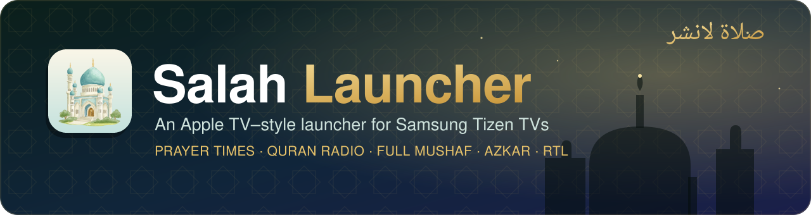
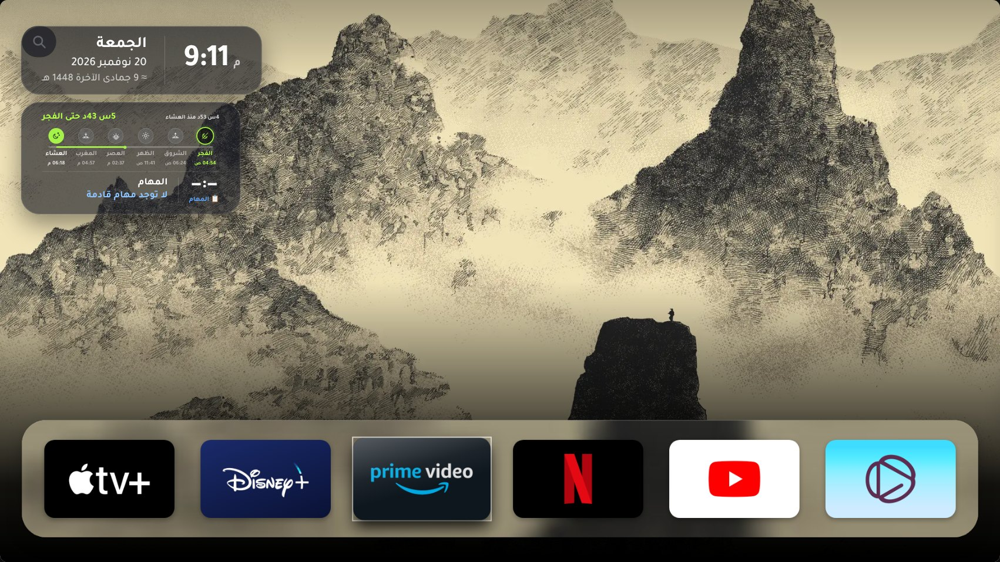
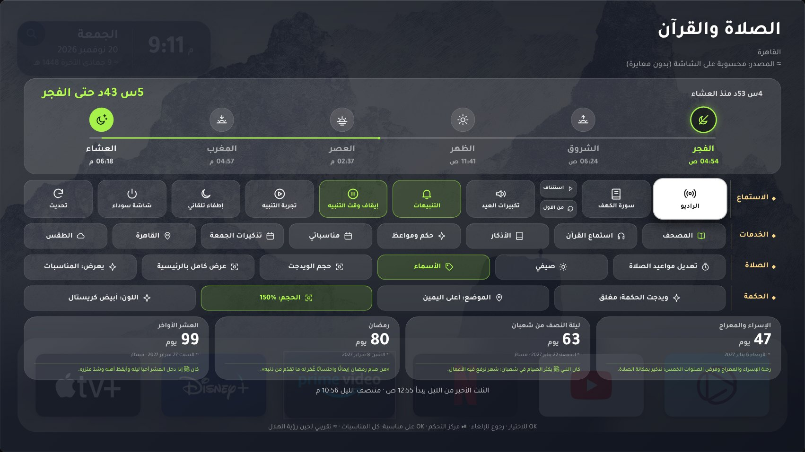
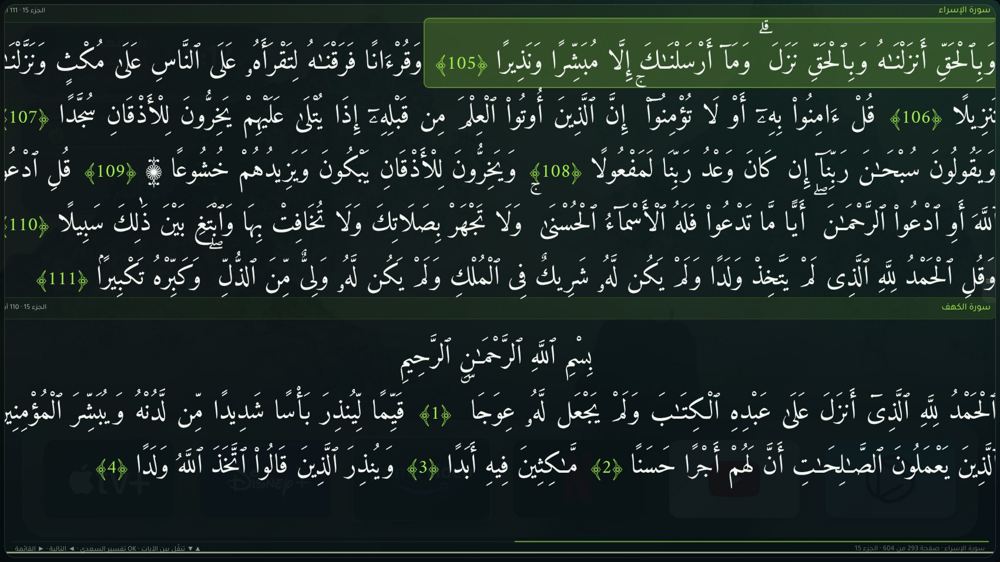
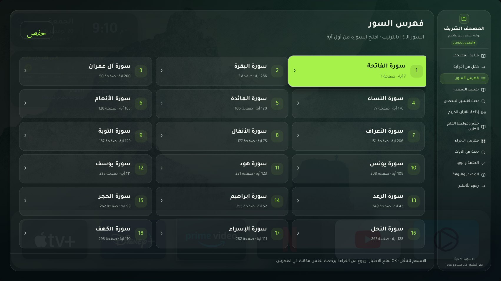
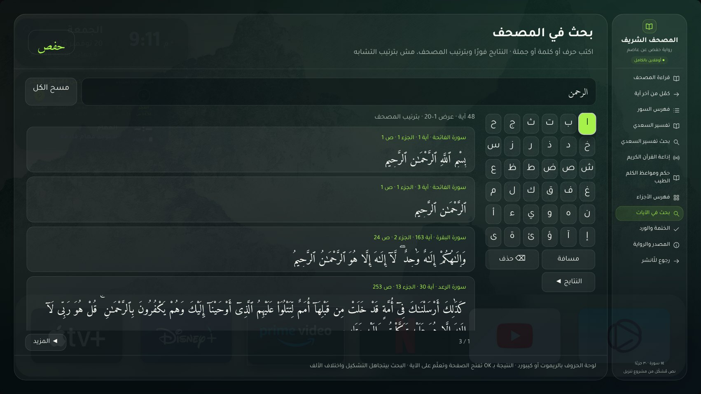
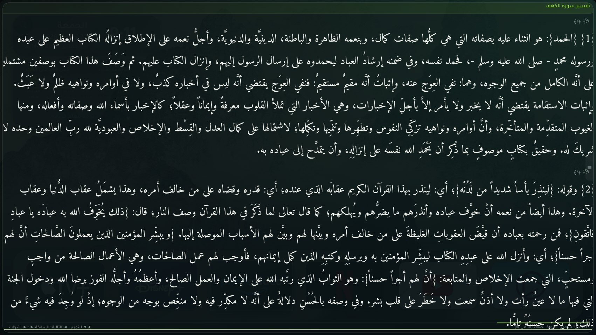
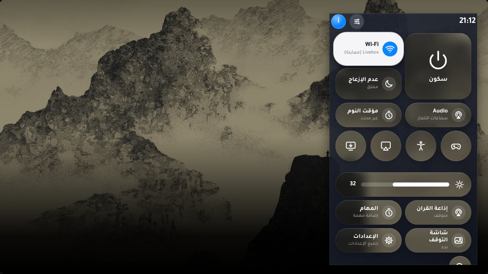
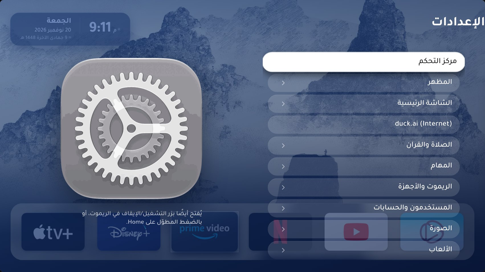

<p align="center">
  
</p>

<p align="center">
  
  
  
  
</p>

<h3 align="center">Your TV's home screen, rebuilt around prayer and the Quran.</h3>

<p align="center">
  Prayer times · Quran radio · A full Mushaf with tafsir · Azkar · Daily life — in one<br>
  Apple&nbsp;TV&ndash;style launcher for Samsung Tizen TVs, made for the remote and for Arabic.
</p>

<p align="center">
  <a href="#why-apl-musalla">Why</a> ·
  <a href="#a-look-inside">Screenshots</a> ·
  <a href="#features">Features</a> ·
  <a href="#install">Install</a> ·
  <a href="#configure">Configure</a> ·
  <a href="#support">Support</a> ·
  <a href="#credits">Credits</a> ·
  <a href="#%D8%B9%D8%B1%D8%A8%D9%8A">عربي</a>
</p>

<p align="center">
  
</p>

---

## Why APL+ Musalla

A TV is the one screen the whole family gathers around, yet its home screen knows nothing about the day's rhythm. **APL+ Musalla** changes that. Open your TV and the first thing you see is the time, the Hijri date, and **how long until the next prayer**. One press away is a complete prayer-and-Quran space that works the way you already use a remote.

- **Always in time.** Prayer times are calculated on the TV itself, so the strip on your Home Screen is there even when the Wi-Fi isn't. Short spoken alerts at each prayer.
- **A Mushaf in your living room.** The full Hafs Quran text, with tashkeel, ships inside the app. No download, no internet, no account.
- **Built for the remote.** Every page is reachable with arrows, **OK** and **Back**, including an on-screen Arabic keyboard for search.
- **Arabic first.** A right-to-left interface with nine bundled Arabic fonts to pick from, not a translation bolted on.
- **Still a launcher.** Your apps, a Control Center, HDMI sources, profiles with a kid lock, tasks and a screensaver — it replaces the clutter, not the apps.

## A look inside

<table>
  <tr>
    <td width="50%"><br><b>Prayer &amp; Quran hub</b><br>Five prayers with a live countdown, radio, alerts, Mushaf, Azkar, wisdom and occasion countdowns on one page.</td>
    <td width="50%"><br><b>The Mushaf</b><br>Hafs text with full tashkeel and verse markers, page and juz' in the corner, OK to open the tafsir of the selected verse.</td>
  </tr>
  <tr>
    <td><br><b>Surah &amp; juz' indexes</b><br>All 114 surahs with verse count and page, plus a separate index of the 30 juz'.</td>
    <td><br><b>Instant search</b><br>Results update on every letter, in Mushaf order, using the on-screen Arabic keyboard.</td>
  </tr>
  <tr>
    <td><br><b>Tafsir</b><br>Tafsir al-Sa'di (Taysir al-Karim al-Rahman) for every surah, bundled and readable offline.</td>
    <td><br><b>Control Center</b><br>Wi-Fi, do-not-disturb, sleep timer, audio, brightness, tasks, Quran radio and settings in one glass panel.</td>
  </tr>
  <tr>
    <td colspan="2"><br><b>Settings</b><br>Appearance, prayer and Quran, tasks, remote buttons, accounts, performance and more.</td>
  </tr>
</table>

<sub>Screenshots come from the launcher's built-in browser preview, so the app shelf shows demo apps and the Wi-Fi name is a placeholder. On a TV the shelf shows your own apps.</sub>

## Features

### Prayer and worship
- **Prayer times** for the day with a live countdown, calculated on the TV and corrected from the AlAdhan service when online. The Egyptian General Authority method is the default.
- **Spoken alerts** at each prayer, a *test alert* button, an option to pause the radio while the alert plays, and a *Friday reminders* option.
- **Hijri and Gregorian dates**, the *last third of the night* and *midnight* times, and countdown cards for **Ramadan**, **the last ten nights**, **mid-Sha'ban** and **Isra and Mi'raj**.
- **Quran radio** from Cairo, **Surat Al-Kahf** with one press, **Eid takbeerat** and a **Ramadan cannon** sound.
- **Azkar**, a **Khatma** tracker and a **Wisdom** widget with sayings and reminders.
- **"My occasions"** for birthdays, anniversaries and family dates, with live ages and reminders.

### The Quran, on your TV
- **Full Mushaf text** (Hafs, Uthmani script, with tashkeel) inside the package, so it opens instantly and offline.
- **Surah index** and a separate **juz' index**, and your place is remembered between sessions.
- **Instant search** while you type, results in Mushaf order, with an on-screen Arabic keyboard made for a remote.
- **Tafsir al-Sa'di** for every surah, plus search inside the tafsir.
- **Quran listening page** with online reciters.
- **Reading comfort:** font size, line spacing, paper and text colour options, and a page that fits the whole screen.

### A real launcher
- **Apple TV–style home** with a glass look, a Top Shelf, a dynamic sky and compact local wallpapers.
- **Home clock** with date and Hijri date, an optional second time zone, **weather** (Open-Meteo, no key needed) and **tasks with countdowns**.
- **Control Center**, **HDMI sources**, **profiles with a kid lock** and app time limits, a **screensaver** and a **light mode**.
- **Backups and a safe mode** that bring you back if something goes wrong.
- **Optional Vetro bridge** to keep alerts alive while other apps are in front.

### Light by design
- No Mushaf page images and no big downloads; shared timers and blur that stays off until you turn it on.
- Written for Tizen 6.5's Chromium 76, with fallbacks for newer APIs.
- Performance switches in Settings, and a start-up time log to measure the effect of any change.

## Install

> Requires a Samsung Smart TV from **2022 or newer** (Tizen 6.5+).

**The easy way: Apps2Samsung** (free, no programming needed)

1. On the TV, turn on **Developer Mode**: **Home › Apps**, type **12345**, switch Developer mode **On**, enter your computer's IP address, then **restart the TV**.
2. Download `apl-plus-musalla-v8.7.18.wgt` from the [Releases page](../../releases) (or directly: [`releases/apl-plus-musalla-v8.7.18.wgt`](releases/apl-plus-musalla-v8.7.18.wgt)).
3. Open [Apps2Samsung](https://github.com/Apps2Samsung/Apps2Samsung/releases) on your computer, select your TV, choose a **custom `.wgt`**, pick the file and press **Install**.
4. Open **APL+ Musalla** from the TV's **Apps** list.

📖 **[Step-by-step guide with troubleshooting, in English and Arabic →](docs/INSTALL.md)**

You can also sideload with Tizen Studio. Many changes in [`app/CHANGELOG.md`](app/CHANGELOG.md) are marked *Untested on physical TV*; [`app/TV-TEST.md`](app/TV-TEST.md) is the checklist to confirm them. Found something? Please open an issue.

## Configure

| What | Where |
| --- | --- |
| Prayer city, weather place, radio stream | `app/js/site-config.js` (defaults: Cairo) or Settings on the TV |
| Support link shown as a QR code | `support.url` in `app/js/site-config.js` |
| Optional API keys (TMDB, YouTube, fanart) | `app/js/keys.local.js` — keep your keys out of commits |

After editing sources, `app/js/app.bundle.js` must be regenerated from `app/js/*.js` (the bundle is what the TV loads). To set the support link and rebuild the package in one step:

```bash
python3 tools/make-support-qr.py "https://your-support-link"
```

## Support

APL+ Musalla is free and open source. If it is useful to you, you can support its development. The same code is in the app under **Settings › Support**.

<!--SUPPORT-START-->
<p align="center">
  <br>
  <a href="https://ko-fi.com/abdulrahmankhalid32781">ko-fi.com/abdulrahmankhalid32781</a>
</p>
<!--SUPPORT-END-->

## Credits

APL+ Musalla is a derivative of **APL Launcher** by Knikt (Gero Corp.), released under the MIT License. The original copyright notice is kept in [`LICENSE`](LICENSE). See [`NOTICE.md`](NOTICE.md) for the full list: Tanzil Quran text, fonts, data sources and trademarks.

APL+ Musalla uses its own package IDs (`APLMusalla`, `APLMusalla.Home`, `APLMusalla.Bridge`), so it installs next to APL Launcher and does not replace it.

## عربي

**APL+ Musalla** مشغّل بشكل Apple TV لشاشات سامسونج (Tizen 6.5 فأحدث)، يحوّل الشاشة الرئيسية لمساحة للصلاة والقرآن: أول ما تفتح الشاشة تشوف الوقت والتاريخ الهجري **والمتبقي على الصلاة القادمة**.

**اللي هتلاقيه جواه**
- **مواقيت الصلاة** بتتحسب على الشاشة نفسها، فتظهر حتى من غير إنترنت، مع تنبيهات صوتية عند كل صلاة.
- **مصحف كامل** برواية حفص بالتشكيل جوه الحزمة، يفتح فورًا من غير إنترنت، مع **فهرس للسور وآخر للأجزاء** و**بحث فوري** أثناء الكتابة بلوحة مفاتيح عربية مناسبة للريموت.
- **تفسير السعدي** لكل السور، **استماع للقرآن** بأصوات قرّاء مختلفين، **إذاعة القرآن الكريم من القاهرة**، **سورة الكهف** بضغطة واحدة، **تكبيرات العيد** و**مدفع رمضان**.
- **الأذكار والختمة والحكم** و**مناسباتي** (أعياد الميلاد والذكريات) مع عدّادات رمضان والعشر الأواخر ونصف شعبان والإسراء والمعراج.
- **مركز تحكم**، ومصادر HDMI، وملفات شخصية مع قفل للأطفال، وحافظ شاشة، ومهام بعدّاد تنازلي، وطقس.
- واجهة عربية من اليمين لليسار بتسعة خطوط عربية، **وخفيفة** على الشاشة.

**للتثبيت:** نزّل ملف `.wgt` من صفحة [Releases](../../releases) وثبّته بأداة **Apps2Samsung** بعد تفعيل وضع المطوّر على الشاشة. الشرح خطوة بخطوة هنا: [دليل التثبيت](docs/INSTALL.md#التثبيت-على-شاشة-سامسونج-بواسطة-apps2samsung). المدينة الافتراضية القاهرة ويمكن تغييرها من الإعدادات.
